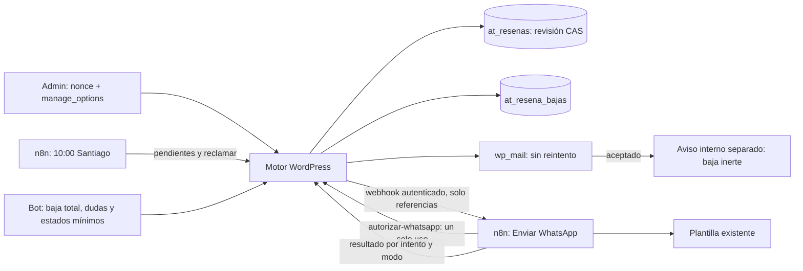
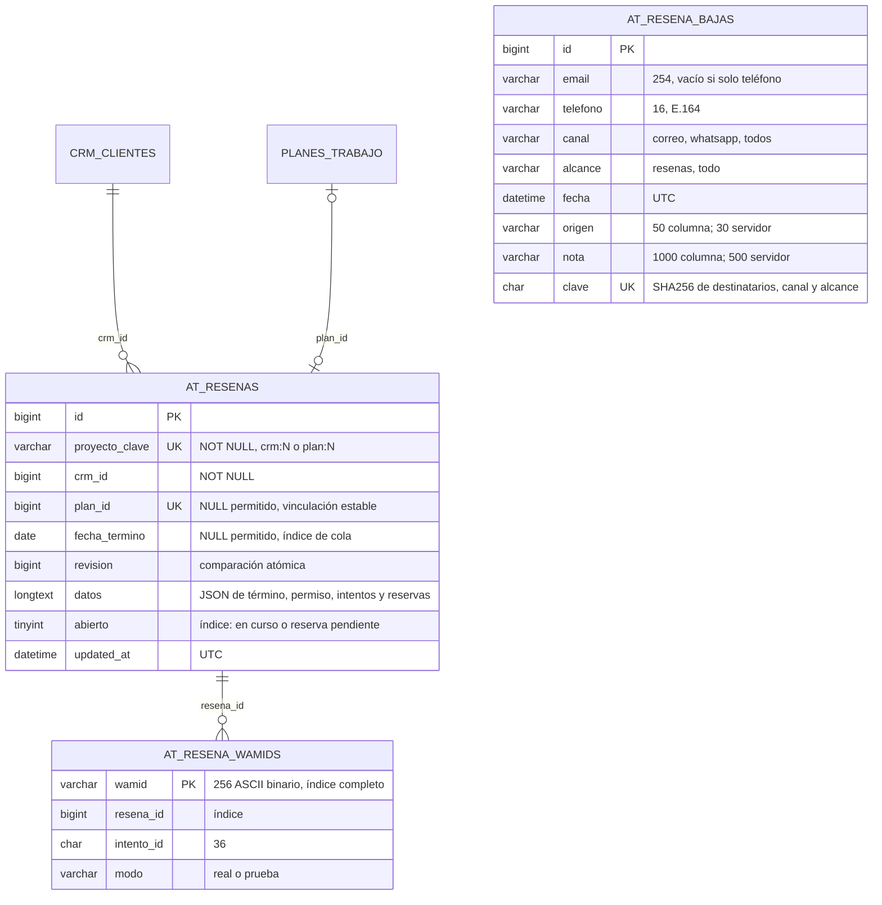

# Estado del proyecto: guía de uso, formato `at-cierre-v1` y despliegue (Etapas 2 y 3)

> **Estado.** Etapa 2: EN PROD desde el 2026-10-14 y **mergeada a `main` el 2026-10-15** (rama `claude/estado-proyecto-e2`, PR #89). Renderer subido por Luis (`/health` ok); flujo n8n «3 Render» con 34 nodos, activo e igual al local (respaldo del anterior fuera del repo); WordPress por SSH: 12 archivos con md5 cotejado, migración hecha (`at_plan_schema` = 2) y caché vaciada. Respaldo de WordPress: `~/respaldos/estado-proyecto-e2-antes-20261014.tar.gz`. Todavía no se ha publicado ningún cierre real. **Etapa 3 (avisar al cliente de un cierre: correo, WhatsApp, descarga del video e historial): EN PROD desde el 2026-10-15** (rama `claude/estado-proyecto-e3`, PR #90): 10 archivos de WordPress por SSH en el orden de la sección 6, con `php -l` y md5 cotejado, y caché vaciada; respaldo `~/respaldos/estado-e3-antes-20261015.tar.gz`. Verificado en PROD: el panel del plan piloto dibuja «📣 Avisar al cliente» en los 3 cierres publicados, sin errores. Todavía no se ha enviado ningún correo de cierre. La Etapa 1 está EN PROD desde el 2026-10-14; ver `PLAN-DE-TRABAJO.md`. Diseño completo: `Docs/superpowers/specs/2026-10-13-estado-del-proyecto-design.md`.
> Los datos de esta guía son inventados (código de plan `AbCdEf123456`, `example.com`): el repositorio es público, no se pegan códigos ni nombres reales de clientes.

## 1. Qué es

El cliente tiene tres presentaciones de su proyecto: la **propuesta**, el **plan de actividades congelado** (el que aprobó y se le envió) y el **«Estado del proyecto»**, que está viva y se actualiza cada vez que cerramos un hito. El cliente solo ve los **cierres publicados**: lo que está en borrador es solo nuestro. **Publicar no envía nada** al cliente (ni correo ni WhatsApp); el cliente entra por el enlace del plan (botón «Ver detalle del avance») o por `ver-estado.php?id=<código del plan>`. Mientras no haya ningún cierre publicado, ve «Pronto verás aquí el avance de tu proyecto» con el enlace a su plan.

## 2. Cómo se usa (Luis)

La sección está en **CRM › ficha del cliente › «🗓️ Plan de trabajo» › «📈 Avance del proyecto»**. Solo aparece con el plan ya **enviado** al cliente.

1. **Crear el cierre con el formulario «➕ Nuevo cierre»** (el camino normal, sin escribir JSON). Se llena: título del hito, fecha en que terminó, el bloque o los bloques del plan que cierra (casillas con los nombres del plan), «Antes / Durante / Después» con sus puntos clave (uno por línea) y las evidencias. Cada evidencia es una fila: se elige el **tipo** (imagen, cifra medida, video o enlace), si **va en «Antes» o en «Después»**, un título y los campos de ese tipo; el archivo se adjunta en la misma fila, **con el nombre que tenga** (el panel lo renombra solo). Empiezan dos filas a la vista y «＋ Agregar otra evidencia» abre más (hasta 12 por cierre en el formulario). Las actividades del plan de esos bloques se agregan solas. «💾 Guardar como borrador» usa **la misma validación** que el JSON: si algo falla no guarda nada, lo muestra en el detalle y **lo escrito vuelve al formulario** (los archivos hay que adjuntarlos otra vez: el navegador no los conserva). Una imagen o video sin adjuntar no impide guardar: queda «falta» y se sube después. **Editar** un borrador: botón «✏️ Editar» en su fila, que llena el mismo formulario; se puede cambiar el título sin crear otro cierre, y las imágenes que no se reemplazan se conservan.
   **Importar el cierre desde un archivo** (cuando una sesión de Claude o Codex lo entrega armado): en «📥 Importar cierre» se adjunta el `.json` (formato `at-cierre-v1`, ver la sección 3; hasta 1 MB) o se pega su contenido, y se adjuntan en el mismo formulario las capturas, videos y portadas, con el **nombre exacto** que dice el JSON (da lo mismo mayúsculas o minúsculas). Valida todo; si hay errores no guarda nada y los muestra en una lista. **Crear, editar o importar nunca rehace la presentación del cliente:** el cliente no ve este cierre hasta que lo publiques. Si el archivo trae además `bloques`, `cambios_plan`, `necesitamos` o `alcance`, esas cuatro listas son datos generales del avance: quedan guardadas al tiro, pero el cliente las ve en la próxima presentación (cuando publiques un cierre o uses «Rehacer la presentación»); si ya hay un cierre publicado, el panel te lo recuerda en el detalle.
2. **Subir lo que falte.** Si algún archivo no vino en el formulario, en la fila del cierre (desplegable «Archivos y edición») cada evidencia con archivo tiene su botón **Subir**. Un cierre con archivos faltantes no se puede publicar.
3. **«👁️ Pedir vista previa con borradores».** Genera una presentación solo para nosotros que incluye los borradores; el cliente no la ve. Se abre con «Abrir la vista previa con borradores». Revisarla antes de publicar.
4. **«✅ Publicar».** Pide confirmación (dice que no se le envía nada al cliente). Pasa el cierre a publicado y se pide rehacer la presentación del cliente.
5. **Esperar unos minutos.** El panel muestra el estado de la presentación: **«Generándose»**, **«Lista»** o **«Con error»**. Si sale «Con error» (o el aviso dice que n8n no recibió el pedido) se usa **«🔄 Rehacer la presentación»**. Con «Lista», aparecen «Ver la presentación publicada» y «PDF».
6. **Verla como la ve el cliente:** `ver-estado.php?id=<código del plan>`.

Otras acciones del panel:

- **↩️ Volver a borrador.** La presentación anterior se oculta **en el acto**, porque ya no refleja lo publicado. El cliente ve «Pronto verás aquí el avance de tu proyecto» hasta que la presentación nueva esté lista, si es que quedan otros cierres publicados (se rehace sola, en unos minutos); si no queda ninguno, se queda con el «Pronto…». Después hay que esperar el «Lista» del panel y revisar `ver-estado.php?id=<código del plan>`. Ojo: la presentación vieja puede seguir abriéndose por su enlace directo del renderer hasta que se rehaga; ese enlace no es la página del cliente.
- **🗑️ Quitar.** Solo un cierre en borrador; borra también sus archivos.
- **Editar un cierre (borrador) en JSON.** Lo normal es «✏️ Editar» (formulario). Para casos que el formulario no cubre (el número de una entrega publicada en `entregable_id`, fechas reales o notas de cada actividad, una evidencia en «Antes» y en «Después» a la vez), en «Archivos y edición avanzada (JSON)» aparece su JSON en un cuadro de texto («💾 Guardar cambios del cierre»). Se valida igual que una importación. Las evidencias que mantienen su nombre de archivo conservan el que ya subimos. **Un cierre publicado no se edita ni admite archivos nuevos:** hay que volverlo a borrador primero (los formularios de subida y el cuadro de edición solo aparecen en borrador).
- **Bloques del plan.** Tabla «Bloques del plan» (por venir, en curso, listo, con fechas reales). Un bloque con un cierre **publicado** que lo cubre se muestra «listo» por sí solo.
- **Cambios de plan, «necesitamos de ti» y alcance** (un formulario con cuatro cuadros de texto):
  - *Cambios de plan acordados*: una línea por cambio, `AAAA-MM-DD | título | detalle`. Al editar el texto de un cambio ya existente se conservan los bloques que tenía vinculados.
  - *Lo que necesitamos del cliente*: una línea por ítem; un `✓ ` al inicio de la línea lo marca como **resuelto**.
  - *Qué incluye la Fase 1* y *qué incluye el servicio mensual*: una línea por ítem. **Vacío = se usan los entregables del plan (Fase 1) o los mensuales del plan.**

**Ojo al reimportar:** el cierre se identifica por su **título**, comparado sin distinguir mayúsculas ni espacios de más. «Diseño del sitio» y «diseño  del  sitio» son el mismo cierre; «Diseño del sitio web» es **otro cierre distinto** y quedan los dos. Si se cambia el título a propósito, quitar el cierre anterior (en borrador) para que no queden duplicados.

### Avisar al cliente de un cierre (Etapa 3)

Cuando un cierre ya está **publicado**, su fila del panel trae, a la vista (no dentro de «Archivos y edición avanzada»), el bloque **«📣 Avisar al cliente»**. **Nada sale solo:** ni al publicar ni al rehacer la presentación; cada aviso es un clic nuestro.

- **«📧 Enviarme una prueba».** Manda el correo «Terminamos: …» a la dirección principal de «Ajustes del cierre», con «[Prueba]» al inicio del asunto, para ver cómo lo recibiría el cliente. Lleva el PDF de la presentación solo si esa presentación ya está lista; si no, va sin PDF y el panel lo dice. Una prueba no marca el cierre como enviado.
- **«📨 Enviar al cliente».** Solo funciona con un cierre publicado cuya presentación se **rehizo después de publicarlo** (el panel muestra «Lista»): así el correo y el PDF reflejan lo que el cliente va a ver. Antes de enviar pide confirmación y muestra el correo del cliente al que irá. Una vez enviado, el botón pasa a **«Reenviar»**, con su propia confirmación. Un doble clic no manda dos correos: el envío se reclama de forma atómica y el segundo clic solo ve que ya hay uno en curso.
- **Mensaje opcional.** Un cuadro de texto encima del botón; si se escribe, va arriba del resumen del cierre (qué se hizo, el antes y el después con sus cifras, lo que sigue y lo que necesitamos del cliente). Si queda vacío, el correo sale solo con el resumen.
- **PDF adjunto.** Se adjunta si pesa hasta 15 MB; si pesa más, el correo lleva solo el enlace a la presentación y el panel avisa que salió sin PDF.
- **Bloqueo por enlaces internos.** Si cualquier enlace o texto del correo (el mensaje opcional incluido) apunta al servidor interno, **no se envía nada** y el panel dice dónde está el problema.
- **«💬 Enviar por mi WhatsApp».** Abre nuestro WhatsApp con el texto ya escrito (también se muestra aparte para copiarlo) y deja anotado en el cierre que se abrió. Lo mandamos nosotros desde el teléfono; el sistema no escribe al cliente por su cuenta.
- **«⬇️ Descargar el video».** Aparece solo para los videos guardados en `automatizatech.cl`; los que viven en otro sitio se ven por su enlace.
- **Historial.** Cada publicación, cada correo al cliente y cada WhatsApp quedan en el historial del CRM con 🏁 y «Equipo AutomatizaTech», y esos cierres se ven con nombre propio en la línea de tiempo. **La prueba no se escribe en el historial del CRM**: solo deja su fecha (`prueba_at`) en el propio cierre, que el panel muestra en «Prueba: enviada el…».
- **El mensaje de la prueba pasa al envío.** Al mandar una prueba con un mensaje, ese mensaje queda guardado en el cierre y el recuadro del correo lo trae ya escrito, para enviarlo al cliente sin reescribirlo. Si el cierre ya salió al cliente, ahí queda el mensaje que de verdad se mandó y una prueba posterior no lo pisa. Una prueba que sale sin PDF (la presentación todavía no está lista) lo avisa con su propio mensaje y el motivo en el detalle.
- **Aviso en el WhatsApp.** Si la presentación todavía no incluye el cierre, junto al botón aparece «Ojo: … espera el «Lista» antes de mandarlo». No bloquea el botón: el texto de WhatsApp solo lleva el enlace.
- **La presentación pública se rehace de a una.** Si ya hay un pedido «pendiente» de hace menos de 10 minutos, un pedido nuevo (publicar otro cierre, guardar bloques, «Rehacer…») no llama a n8n: queda en cola y sale solo cuando llega la devolución del que está en curso. Solo la devolución del último pedido deja la presentación «Lista»; así un «Lista» posterior a publicar un cierre siempre trae ese cierre. Pasados 10 minutos sin respuesta el pedido se da por perdido y el siguiente sale normal. La vista previa no usa cola.

Dónde queda lo enviado: en cada cierre, `correo` (`enviado_at`, `prueba_at`, `mensaje`, `enviando`, `a`) y `whatsapp` (`abierto_at`). Reimportar un borrador con el mismo título **conserva** esas marcas, y la presentación que vuelve del renderer nunca las borra.

## 3. Formato `at-cierre-v1`

Es un JSON en UTF-8. Lo prepara la sesión de Claude Code o Codex que cerró el hito, en el PC de Luis, y Luis lo importa (la sesión no toca producción). Cualquier error en un solo campo hace que **no se guarde nada**.

| Campo | Tipo y reglas |
|---|---|
| `formato` | Siempre `"at-cierre-v1"`. |
| `plan` | El código del plan (aquí `AbCdEf123456`). Debe coincidir con el de la ficha donde se importa; si no, se rechaza. |
| `cierre.titulo` | Texto, hasta 120 caracteres. Identifica el cierre (ver «Ojo al reimportar»). |
| `cierre.bloques` | Lista de nombres de bloques **que existen en el plan firmado** (no distingue mayúsculas). Al menos uno. |
| `cierre.fecha_real` | `AAAA-MM-DD`, la fecha real en que se cerró el hito. |
| `cierre.entregable_id` | Número; `0` si el cierre no tiene una entrega publicada en «Entregables». Debe ser un entregable **del mismo cliente** del plan: si no existe o es de otro cliente, se rechaza el archivo («El entregable N no existe o no es de este cliente.»). |
| `cierre.antes` / `cierre.despues` | `texto` (hasta 2.000 caracteres), `puntos` (hasta 8, de hasta 200 caracteres cada uno) y `evidencias` (lista de `ref`, que deben existir en `evidencias[]`). |
| `cierre.durante` | `texto` (hasta 2.000) y `actividades` (hasta 30): `{bloque, nombre, real, nota}`. El `bloque` debe estar entre los del cierre; `real` es `AAAA-MM-DD` o vacío; `nota` hasta 300. Si se **omite** `actividades`, se precargan las del plan para esos bloques. Una actividad con un nombre que el plan no tiene entra sin fechas planificadas y con un aviso. |
| `evidencias[]` | Hasta 60 por plan (30 cierres como máximo). Cada una trae `ref`, `tipo` y `titulo` (hasta 120). Detalle abajo. |
| `bloques` | Opcional. Objeto `{ "Nombre del bloque": { "estado": "listo" \| "en_curso" \| "por_venir", "inicio_real": "AAAA-MM-DD", "fin_real": "AAAA-MM-DD" } }`; las fechas pueden ir vacías y el fin no puede ser anterior al inicio. |
| `cambios_plan` | Opcional, hasta 30: `{fecha, titulo (120), detalle (600), bloques[]}`. **Si el archivo trae esta clave, reemplaza la lista completa**; si no la trae, no se toca. |
| `necesitamos` | Opcional, hasta 30: `{texto (200), estado: "abierto" \| "resuelto", fecha}`. Igual: si viene, reemplaza la lista. |
| `alcance` | Opcional: `{fase1: [...], mensual: [...]}`, hasta 20 ítems de 200 caracteres cada lista. Igual: si viene, reemplaza. |

**Evidencias por tipo.** `ref` solo admite **minúsculas, números y guiones, hasta 40 caracteres, empezando con letra o número**. Usa siempre refs con al menos una letra (`portada`, `velocidad-antes`): los refs formados solo por dígitos (`1`, `2`) tienen un problema conocido, no los uses.

| `tipo` | Campos |
|---|---|
| `cifra` | `valor` (hasta 40) **obligatorio**, `unidad` (hasta 60), `fuente` **obligatoria** (hasta 200) y `fecha` **obligatoria**. Una cifra sin fuente y fecha no se acepta. |
| `enlace` | `url` obligatoria: `https://`, sin espacios ni comillas, hasta 500 caracteres, y **nunca** del servidor de Easypanel (el correo de Hostinger rechaza esos enlaces). |
| `captura` | `archivo`: nombre `.jpg`, `.jpeg`, `.png` o `.webp`. |
| `video` | `archivo`: nombre `.mp4` o `.webm`; `poster` opcional: nombre de imagen. |

Reglas de los textos: se guardan tal cual (un «<90» o «menos de <3 segundos» no se corta), pero un texto que lleve una **etiqueta HTML** (p. ej. `<script>`) rechaza el archivo entero. Las fechas van entre 2020 y 2100. La `ref` de una evidencia lleva al menos una letra (`a1` vale, `1` no).

`fuente` y `fecha` son opcionales en los demás tipos. Los nombres de archivo llevan letras, números, punto, guion y guion bajo (hasta 120).

**Qué se guarda de lo importado.** Solo se guardan las evidencias que **«Antes» o «Después» nombran**. Una evidencia que ninguna de las dos usa se avisa («no se mostrará») y **no se guarda**; tampoco se le sube su archivo.

**Reimportar el mismo título.**

- *Borrador:* se reemplaza el cierre conservando su identificador. Las evidencias con la **misma `ref` y el mismo nombre de archivo** conservan el archivo ya subido; las demás se descartan y sus archivos viejos se borran.
- *Publicado:* se rechaza con «pásalo a borrador antes de importarlo de nuevo».

### Archivos: qué acepta el panel

Los archivos se asocian a cada evidencia **por nombre** (sin distinguir mayúsculas) con su `archivo` o su `poster`. Un archivo que no corresponde a ninguna evidencia del cierre se avisa y no se guarda. Los archivos quedan en `wp-content/uploads/at-estado/<id del plan>/` con nombres aleatorios.

- **Imágenes (capturas y portadas):** JPEG, PNG o WebP, hasta **15 MB**, hasta **12.000 px por lado y 25 millones de píxeles**. Se reducen a **2.000 px** de lado mayor, se les quita el EXIF (incluido el GPS) y las fotos de celular se giran a su posición correcta. Un WebP con transparencia se guarda como JPG.
- **Videos:** MP4 o WebM, hasta **200 MB**, se guardan tal cual. El tipo se mira por el contenido, no por la extensión. El MP4 debe tener una marca de video común: sirven las grabaciones del celular, de grabadores de pantalla y las exportaciones de editores. Una foto HEIC o AVIF **no** es un video y se rechaza.
- **Portada («poster») del video:** opcional. Se sube en WordPress junto con el video, ya sea en «Importar cierre» (adjuntándola en el mismo formulario) o después, con el botón **Subir** de esa evidencia (fila «Póster (opcional)»). **Hostinger no puede generarla** (no tiene ffmpeg). Quien prepara el archivo del cierre en el PC de Luis puede generarla con ffmpeg y entregarla junto al video. Sin portada, el recuadro del video se ve oscuro hasta reproducirlo y el PDF muestra «▶ Ver el video» con el enlace.

## 4. Ejemplo completo

Archivo: `Docs/METODO_AT/ejemplos/cierre-at-cierre-v1-ejemplo.json`. Valida contra un plan de prueba con los bloques «Diseño», «Desarrollo» y «Puesta en marcha» (lo comprueba `at_av_validar_import`). Los archivos `portada-nueva.png`, `recorrido.mp4` y `recorrido-poster.jpg` son ficticios: hay que adjuntar los reales.

```json
{
  "formato": "at-cierre-v1",
  "plan": "AbCdEf123456",
  "cierre": {
    "titulo": "Diseño del sitio",
    "bloques": ["Diseño"],
    "fecha_real": "2026-10-09",
    "entregable_id": 0,
    "antes": {
      "texto": "El sitio usaba una plantilla genérica, sin las fotos del equipo actual.",
      "puntos": ["Plantilla genérica", "Fotos de personal que ya no trabaja ahí"],
      "evidencias": ["velocidad-antes"]
    },
    "durante": {
      "texto": "Diseñamos la portada y las páginas internas, y las revisamos contigo.",
      "actividades": [
        { "bloque": "Diseño", "nombre": "Maqueta de la portada", "real": "2026-10-06", "nota": "" }
      ]
    },
    "despues": {
      "texto": "Quedó aprobada la maqueta del sitio nuevo.",
      "puntos": ["Maqueta aprobada el 9 de octubre"],
      "evidencias": ["velocidad-despues", "portada", "recorrido", "maqueta"]
    }
  },
  "evidencias": [
    { "ref": "velocidad-antes", "tipo": "cifra", "titulo": "Velocidad en celular", "valor": "56", "unidad": "puntos de 100", "fuente": "PageSpeed Insights", "fecha": "2026-10-06" },
    { "ref": "velocidad-despues", "tipo": "cifra", "titulo": "Velocidad en celular", "valor": "92", "unidad": "puntos de 100", "fuente": "medición local", "fecha": "2026-10-09" },
    { "ref": "portada", "tipo": "captura", "titulo": "Portada nueva", "archivo": "portada-nueva.png" },
    { "ref": "recorrido", "tipo": "video", "titulo": "Recorrido de la maqueta", "archivo": "recorrido.mp4", "poster": "recorrido-poster.jpg" },
    { "ref": "maqueta", "tipo": "enlace", "titulo": "La maqueta en línea", "url": "https://example.com/maqueta" }
  ],
  "bloques": { "Desarrollo": { "estado": "en_curso", "inicio_real": "2026-10-12", "fin_real": "" } },
  "cambios_plan": [
    { "fecha": "2026-10-08", "titulo": "La publicidad pasa al servicio mensual", "detalle": "Lo acordamos por correo.", "bloques": [] }
  ],
  "necesitamos": [ { "texto": "Logo en alta resolución", "estado": "abierto", "fecha": "2026-10-08" } ],
  "alcance": { "fase1": ["Sitio web publicado"], "mensual": ["Publicidad y visibilidad"] }
}
```

## 5. Dónde viven las cosas

| Qué | Dónde |
|---|---|
| Datos del avance | Columna `avance` de la tabla de planes. La migración la crea y deja `at_plan_schema` = `2` (`at_av_migrar_esquema()`). |
| Archivos de evidencias | `wp-content/uploads/at-estado/<id del plan>/` (con su `.htaccess` propio: sin código, sin listado, `noindex`, `no-transform`). |
| Lógica en WordPress | `wp-content/themes/automatiza-tech/inc/plan-trabajo/`: `avance-puras.php` (validación, sin WordPress), `avance-datos.php`, `avance-evidencias.php`, `avance-render.php` y `avance-panel.php`; se enganchan en `cargar.php`. Cambiados: `datos.php`, `rest.php`, `panel.php`, `vista.php` y `assets/css/plan-trabajo.css`. |
| Página del cliente | `ver-estado.php` (raíz del sitio) → `at_pt_html_ver_estado()` en `vista.php`. |
| Presentación | `renderer/src/template-estado.js` (servicio del renderer en Easypanel). |
| Flujo n8n | Rama `estado` de «Plan de trabajo · 3 Render» (`N8N/plan-trabajo/plan-3-render.json`, generado por `build_plan_3_render.py`, 34 nodos). **Nunca manda correo a Luis**: el resultado se ve en el panel («Lista» / «Con error» / «Generándose»). |
| Pruebas | `tests/plan/` (WordPress y sin WordPress), `renderer/test/`, `N8N/plan-trabajo/probar_plan.py`. |

## 6. Para PROD (en este orden; cada paso con el OK de Luis, respaldo y verificación desde afuera)

Luis sube solo el zip del renderer a Easypanel; el resto se despliega por API y SSH con su autorización explícita. **Antes de subir cualquier archivo de WordPress, respaldar el que se sobrescribe y cotejar su md5 contra `main`** (una copia local vieja hace revisar el archivo equivocado).

| Orden | Local | Destino | Clase |
|---|---|---|---|
| 1 | zip de `renderer/` de esta rama | Easypanel, servicio del renderer (lo sube Luis) | OBLIGATORIO |
| 2 | `N8N/plan-trabajo/plan-3-render.json` (34 nodos) | n8n: `python N8N/propuestas-v3/deploy.py <ruta absoluta>` | OBLIGATORIO |
| 3 | `inc/plan-trabajo/avance-puras.php`, `avance-datos.php`, `avance-evidencias.php`, `avance-render.php`, `avance-panel.php` (nuevos) | mismas rutas en `wp-content/themes/automatiza-tech/` | OBLIGATORIO, **antes** que `cargar.php` |
| 4 | `inc/plan-trabajo/datos.php`, `rest.php`, `panel.php`, `vista.php` y `assets/css/plan-trabajo.css` | mismas rutas | OBLIGATORIO (respaldar y cotejar md5 contra `main`) |
| 5 | `inc/plan-trabajo/cargar.php` | misma ruta | OBLIGATORIO, **al final** de WordPress |
| 6 | `ver-estado.php` | raíz de `public_html` | OBLIGATORIO |
| 7 | migración: `wp eval 'at_av_migrar_esquema(); echo get_option("at_plan_schema");'` → `2` | PROD | OBLIGATORIO |
| — | `tests/`, `Docs/`, `.superpowers/` | — | NO subir |

La migración (paso 7) va **justo después de subir** los archivos (o entrando una vez al escritorio de WordPress, que la corre sola). Sin ella el panel muestra el aviso «Falta preparar la base para el avance» y el `GET` del render del estado responde **409**.

Verificación desde afuera tras el despliegue: `ver-estado.php?id=<código>` con un plan enviado (sin cierres: «Pronto…»); importar un cierre de prueba en una ficha de prueba, vista previa, publicar y comprobar «Lista»; abrir un archivo subido bajo `uploads/at-estado/` y revisar sus cabeceras (`no-transform`, `noindex`).

**Formulario «Nuevo cierre» (añadido después del despliegue del 14-oct, sin migración ni cambios en n8n ni en el renderer):**

| Orden | Local | Destino | Clase |
|---|---|---|---|
| 1 | `inc/plan-trabajo/avance-puras.php` | misma ruta | OBLIGATORIO, **antes** que el panel (el panel llama sus funciones nuevas) |
| 2 | `inc/plan-trabajo/avance-panel.php` | misma ruta | OBLIGATORIO |
| 3 | `assets/css/plan-trabajo.css` y `assets/js/plan-trabajo.js` | mismas rutas | OBLIGATORIO (sin el CSS, cada fila muestra todos sus campos; sin el JS, «＋ Agregar otra evidencia» no abre filas) |

**Etapa 3 — avisar al cliente de un cierre (EN PROD desde el 2026-10-15; sin migración, sin n8n y sin renderer):**

| Orden | Local | Destino | Clase |
|---|---|---|---|
| 1 | `inc/plan-trabajo/cierre-puras.php` y `cierre-correo.php` (nuevos) | mismas rutas en `wp-content/themes/automatiza-tech/` | OBLIGATORIO, **primero** (`cargar.php` los exige: sin ellos el tema se cae) |
| 2 | `inc/plan-trabajo/cargar.php` | misma ruta | OBLIGATORIO, **justo después** del paso 1 |
| 3 | `inc/plan-trabajo/avance-datos.php`, `avance-puras.php`, `envio.php`, `avance-render.php`, `avance-panel.php` y `assets/css/plan-trabajo.css` | mismas rutas | OBLIGATORIO (respaldar y cotejar md5 contra `main`). Dentro del paso: `avance-datos.php` y `avance-puras.php` antes que `avance-render.php` y `avance-panel.php` (estos llaman funciones de aquellos) |
| 4 | `wp-content/mu-plugins/at-timeline-origen.php` | misma ruta (`wp-content/mu-plugins/`) | OBLIGATORIO (sin él la línea de tiempo no muestra los 🏁) |
| — | `tests/`, `Docs/`, `.superpowers/` | — | NO subir |

**Por qué este orden:** el panel nuevo (paso 3) llama funciones que solo existen cuando `cargar.php` ya carga los archivos nuevos (paso 2), y `cargar.php` falla si los archivos del paso 1 todavía no están; subirlos al revés deja una ventana con errores fatales en la ficha del CRM.

Verificación desde afuera tras subir: abrir el panel de un plan con un cierre publicado y comprobar el bloque «📣 Avisar al cliente»; «📧 Enviarme una prueba» y revisar que el correo llegue con «[Prueba]»; recién entonces, con nuestro OK, el envío al cliente.

**Rollback de la Etapa 3:** restaurar los archivos del tema y el mu-plugin desde el respaldo y borrar `cierre-puras.php` y `cierre-correo.php`. Los datos `correo` y `whatsapp` quedan en cada cierre sin efecto: sin el código nadie los lee.

**Rollback (Etapa 2):** reponer el zip anterior del renderer; reimportar el `plan-3-render.json` de `main`; restaurar los archivos de WordPress desde el respaldo y borrar los `avance-*.php`. La columna `avance` puede quedar: nadie la lee sin el código.

## 7. Qué no se ha probado

Todo lo de esta etapa corrió en local (pruebas automáticas, WordPress local, renderer y flujo n8n contra datos de prueba). **No se ha probado:**

- El **flujo n8n real** y el **renderer** en producción (Easypanel): solo el generador y las pruebas locales.
- Un **video real de 13 MB subido por el navegador** a producción. Los topes de PHP en Hostinger se midieron el 13-oct (acepta subidas de hasta 2 GB, según la especificación), pero nunca se subió un video de verdad por este panel.
- Que LiteSpeed **respete el `.htaccess`** de `uploads/at-estado/` (`mod_headers`: `noindex`, `no-transform`, caché) y que el **CDN de Hostinger respete `no-transform`** (hoy recodifica y achica imágenes si no se le dice).
- La **presentación vista en un celular** real.
- La Etapa 4 (piloto con un cliente) **no está construida**.
- **Etapa 3, todo corrió solo en local con pruebas automáticas** y no se ha probado:
  - Un **correo real por el SMTP de Hostinger con el PDF adjunto** (tamaño, entrega y cómo lo muestran Gmail y Outlook).
  - El enlace **wa.me abierto en el celular** de Luis, con el texto ya escrito.
  - La **descarga del video en iPhone** (Safari).
  - Una **carrera real de dos clics simultáneos** en «Enviar al cliente»: el reclamo atómico está probado en las pruebas automáticas, no con dos navegadores.

## 8. Pedir reseña (implementación local, 19-nov-2026)

**Estado: LOCAL, sin desplegar, sin enviar mensajes ni activar n8n.** Plan aprobado: [v4](../superpowers/plans/2026-11-19-resena-google-cierre.md). Autor A del módulo: Forja-Codex; Vuelta 7: Forja-Codex sobre `0459a27`, ajustes solicitados por Toga-Claude y decisiones de Luis del 22-nov; revisión de Eje pendiente. Evidencia y checklist: [informe A](../superpowers/plans/2026-11-19-resena-google-cierre-implementacion-A.md#vuelta-7). Las referencias históricas de PROD de las secciones anteriores no describen este módulo.

### Uso

1. En la ficha CRM de tipo **cliente**, abrir **⭐ Reseña**; también aparece dentro de **Plan de trabajo › Avance**. Solo administradores con `manage_options` pueden actuar. Abrir el panel no crea ni vincula registros: se crean al actuar, después de validar permiso, nonce y cliente. Sin plan, se crea una identidad `crm:<id>`; cuando se vincula el primer plan al actuar, se conserva. Si hay varios proyectos del cliente, abrir el plan concreto. Un plan reasignado queda bloqueado con «el plan fue reasignado a otro cliente: revisar a mano»; no se migra el registro anterior.
2. Registrar **WhatsApp autorizado**, origen de la autorización explícita y fecha. Queda ligado al teléfono actual y a estas invitaciones. Cambiar el teléfono exige acreditar el permiso de nuevo. No se importa automáticamente la casilla de Retomar, que no contiene esa evidencia.
3. Con **🏁 Marcar proyecto terminado**, guardar la fecha efectiva; no es el cierre de un hito. Automáticamente se consideran fechas desde el 19-nov-2026, tras siete días calendario de Santiago. El reloj consulta hasta diez elegibles, ordenados por fecha; los bloqueados no ocupan ese cupo.
4. **✉️ Enviar ahora** exceptúa solo la espera y el corte histórico. Siempre se comprueban cliente, fecha válida, enlace, canales, bajas, permiso y marcas. **🧪 Enviarme una prueba** exige ambos destinos de prueba configurados; sustituye el destinatario principal y WhatsApp por los de prueba y retira copias implícitas. Después de la aceptación envía el aviso interno separado a la casilla corporativa configurada, sin enlace de baja accionable. Conserva su modo, no anota un envío al cliente ni consume cupos reales. Conserva hasta veinte intentos de prueba por proyecto; al llegar al límite hay que revisar, no borrar marcas reales.
5. El Schedule ofrece **un único recordatorio automático para todos** a partir de siete días desde la primera invitación real tramitada (al menos un canal aceptado), incluso si fue enviada manualmente a un proyecto histórico. Exige ausencia de baja, exclusión, incertidumbre, reenvío previo y marca de reseña recibida. **🔁 Volver a enviar** queda para reparar fallas verificadas, con motivo objetivo obligatorio (máximo 500 caracteres), guardado en el intento; el motivo no puede ser una expectativa de opinión. Cualquier intento real de tipo reenvío agota el único recordatorio, aunque falle. Un intento de invitación totalmente fallido no consume invitación: **✉️ Enviar ahora** vuelve a estar disponible como invitación sin esperar siete días, y el automático puede retomarlo en su siguiente corrida si sigue elegible. Al acumular **3 intentos reales totalmente fallidos por proyecto**, se bloquean nuevos envíos reales y se reserva un único aviso a Luis. Las pruebas no cuentan al tope. Deshacer el término solo se permite mientras no haya invitaciones que consuman cupo; conserva todos los intentos y el tope.

**Configuración sin valores:** opciones `at_resena_google_url`, `at_resena_prueba_email`, `at_resena_prueba_telefono`. El destino n8n es la constante del tema `AT_N8N_RESENA_WHATSAPP`: `https://n8n-n8n.kchiba.easypanel.host/webhook/at-resena-whatsapp`, coincidente con `aplicar.py`; ya no se consulta `at_resena_whatsapp_webhook`. No se proporcionan destinatarios desde el navegador ni desde n8n. La credencial de máquina sigue usando `AT_REST_SECRET` y `X-AT-Secret`; no se incluye en opciones ni JSON de flujos. Un secreto propio requiere provisionar y alinear WordPress y la credencial del webhook n8n; se deja pendiente para un encargo autorizado, sin inventarlo ni escribirlo en el tema o tocar wp-config. Administrar opciones por el canal ya autorizado; no pegar secretos en comandos.

**✉️ Aviso interno separado (vuelta 7, reemplaza BCC de vuelta 5):** la opción histórica `at_resena_copia_oculta` se configura al desplegar con una única casilla **corporativa de AT**, sin valor predeterminado ni dirección en el código. Ausente, vacía, inválida o igual al destino = sin aviso. Rechaza listas, CR/LF y tipos inesperados. El cliente tiene un solo To, sin CC ni BCC. Tras `wp_mail()===true`, un segundo mensaje lleva el asunto «[Copia] Invitación a reseña enviada · {proyecto}», la misma vista HTML con el enlace de baja reemplazado por «[enlace de baja del cliente]», correo del cliente enmascarado (ma***@ejemplo.cl), AltBody igualmente inerte y la leyenda «Copia interna; bórrala a los 90 días (política de conservación)». No lleva `List-Unsubscribe` ni `List-Unsubscribe-Post`. Su fallo o excepción no altera el envío aceptado del cliente. Aplica a invitación, prueba y reenvío. El panel muestra «Aviso interno activo/inactivo» con casilla enmascarada, sin edición. La eliminación a los 90 días en el buzón corporativo es una política operativa que debe configurar su responsable; WordPress no tiene acceso para borrar esos correos.

Al desplegar, por el canal autorizado, configurar `wp option update at_resena_copia_oculta <correo>` (reemplazar el marcador fuera del repo). Para desactivar solo la copia: `wp option update at_resena_copia_oculta ''`. Estos comandos están documentados, **no ejecutados** en este encargo. No escribir correos reales en código, pruebas, informes ni capturas del repo público.

**✉️ Correo con marca AT (vuelta 6, 21-nov):** maqueta aprobada, tablas y estilos en línea, máximo 600 px, logo real de 220 px y cuatro contactos públicos de AT con PNG Phosphor 2.1.1 de 40×40 mostrados a 20 px (sitio, correo, WhatsApp e Instagram). Asunto «{nombre}, ¿cómo te fue con AutomatizaTech?»; sin nombre «¿Cómo te fue con AutomatizaTech?», con `[Prueba] ` cuando corresponda. El nombre se limpia de etiquetas, saltos y controles y se limita a 60 caracteres UTF-8. Firma «Equipo AutomatizaTech»; texto honesto aprobado, sin solicitar una puntuación. La única ⭐ es el ícono del botón aprobado. Incluye alternativa de texto plano (`AltBody`), `List-Unsubscribe` con la misma URL firmada del cuerpo y `List-Unsubscribe-Post: List-Unsubscribe=One-Click`. Vuelta 7 agrega sobre la baja la identidad AUTOMATIZATECH SpA, la relación con {proyecto} y el enlace a https://automatizatech.cl/privacidad/ tanto en HTML como en AltBody. Los filtros cierran cada mensaje a un único destinatario; los hooks se retiran en `finally`. Los avisos operativos no heredan las cabeceras de baja ni el texto alternativo de una invitación. Vuelta 6 no cambió esquema, cupos ni rutas públicas; los cambios de baja y recordatorio de vuelta 7 se describen aquí y en su informe. Suite offline y MIME de vuelta 6 verificados; recepción Gmail/Outlook, móvil real y captura de navegador NOT_RUN por permisos del entorno. Lista incremental de los cuatro PNG obligatorios y del PHP en el informe A, Vuelta 6; no desplegado.

**WhatsApp:** acepta E.164 con `+`; si comienza con `+56`, exige `^\+569[0-9]{8}$` (móvil chileno). Normaliza 11 dígitos `569XXXXXXXX` a `+569XXXXXXXX` y elimina separadores visuales. El esquema versionado de `crm_clientes` no tiene campo de país (DDL en `crm-ai-completo.php`); no se infiere desde el rubro, dominio ni otros datos. Por eso se rechazan los nueve dígitos nacionales sin prefijo: solo se podrían completar con +56 si existiera país Chile acreditado en CRM. Esta vuelta no agrega una columna. El panel explica ese motivo y muestra el número normalizado que se usará. Los destinos de prueba también requieren prefijo. Continúa siendo obligatorio el permiso ligado al teléfono normalizado y sin baja.

**Sin enlace de Google no sale ningún canal**, tampoco pruebas o envíos manuales. `/resena/` devuelve una página neutra 404; configurada una URL HTTPS de Google con ruta admitida, responde 302 sin caché. El perfil real y la disponibilidad de la plantilla deben verificarse antes de activar. El mensaje pide una experiencia honesta, sin incentivos ni selección por satisfacción.

### Bajas

- El correo lleva una URL con id de registro, UUID y firma HMAC con dominio `at-resena-baja|` de la sal `auth`, vinculada al correo guardado en ese intento. No lleva correo ni teléfono en la URL. Abrirla no registra nada: ofrece «Solo dejar de recibir invitaciones a reseñar» (`alcance=resenas`) y «No recibir ninguna comunicación promocional de AutomatizaTech» (`alcance=todo`). POST busca primero el token en el cuerpo y, si falta, en la query. El POST RFC 8058 con `List-Unsubscribe=One-Click` y token solo en la query guarda `canal=correo, alcance=resenas`, responde 200 sin formulario y es idempotente. Un fallo de escritura responde 503, sin afirmar baja. El token inválido responde 400. No se usa un nonce de sesión: la autorización es el token firmado. Cambiar la sal o este prefijo invalida enlaces anteriores; el prefijo nuevo se introduce antes de PROD. El cliente puede responder al correo para pedir baja.
- El panel registra bajas por destinatario, canal y alcance; se aplican en todos sus proyectos. `todos` incluye correo y WhatsApp; `resenas` y `todo` bloquean estas invitaciones. La función pública **`at_rg_baja_total(string $email, string $telefono): bool`** normaliza los identificadores y consulta cualquier baja con alcance `todo` para ese destinatario. Ante error de BD devuelve true para no habilitar promociones sin verificar. **Retomar y Prospección deben consultarla antes de sus comunicaciones promocionales; su integración NO está incluida en esta vuelta**. La supresión propia de reseñas sigue respetando canal y alcance; el recordatorio se detiene ante cualquier baja coincidente. La exclusión de un proyecto exige un motivo objetivo y no reemplaza una baja general.
- El bot enviará `POST /wp-json/at/v1/resena/baja`, autenticado, con `{telefono:"+56900000000", texto:"BAJA"}` (ejemplo ficticio). El servidor normaliza tildes, mayúsculas y puntuación. Reconoce respuestas que sean o empiecen por baja, stop, darme de baja, no me escriban o no quiero recibir y registra `canal=whatsapp, alcance=todo`. Si solo contiene baja/stop sin empezar con esas frases, no registra una baja y reserva un aviso por conversación (teléfono normalizado) por día de Santiago para revisión de Luis. La reserva persiste incluso si falla el aviso; el estado fallido exige revisión, sin reenvío automático. No guarda el texto ambiguo en la reserva. El generador incluye un adaptador offline que conserva el texto original, intercepta solicitudes y dudas antes del bot y conserva la salida original para mensajes normales; Eje debe contrastar los campos de la exportación real antes de instalarlo. El endpoint y las consultas de supresión están implementados; el bot vivo no fue modificado.

### Estados, revisión y liberación

`wp_mail() === true` significa **aceptado por el servidor**, y un `wamid` significa **aceptado por Meta**. Entregado/leído requiere el webhook. El panel muestra los estados de ambos canales: no intentado, en curso, aceptado, fallido, desconocido; WhatsApp añade entregado y leído. Un canal ausente queda no intentado; un canal aceptado tramita la invitación, con resultado parcial si el otro falló. Los dos fallidos quedan Fallida. Solo un fallo total comprobado puede volver a entrar al automático, con las mismas guardas y el tope de tres; lo incierto requiere revisión.

Antes del proveedor se persiste el intento. A los treinta minutos sin confirmación, el canal queda **desconocido** y bloquea reenvíos; hay un aviso operativo reservado una sola vez por evento. El mantenimiento lo ejecutan las consultas del reloj y WP-Cron horario. Más de 26 horas sin consulta exitosa de pendientes genera un aviso desde la última corrida o desde el inicio del monitoreo. WP-Cron depende del tráfico o del disparador del hosting; verificarlo en el despliegue.

Un `/resultado` tardío válido con `wamid` puede promover **desconocido→aceptado**, y después a entregado/leído según los estados, sin realizar otro envío. El panel lo advierte. Conserva como máximo **20 pruebas** por proyecto, sujetas al plazo de conservación: al llegar a veinte bloquea nuevas pruebas y muestra el aviso.

**Decisión de Luis M4 (19-nov):** `at_rg_consume_cupo()` no cuenta los intentos reales cuyos canales intentados terminaron todos `fallido`. `fallido + no_intentado` también es fallo total; `no_intentado` no significa enviado ni suma por sí solo un fallo. Cualquier canal `aceptado`, `entregado`, `leido`, `en_curso` o `desconocido` conserva el cupo. El reloj nunca repite un resultado incierto. Los fallos totales se cuentan en el JSON conservado, independientemente de si correspondían a invitación o reenvío; al tercero bloquea tanto «Enviar ahora» como «Volver a enviar» y el automático. El panel muestra el bloqueo y la cuenta. El aviso de tope usa la reserva persistente `aviso:limite_fallidos`, sin otro aviso por canal al alcanzar el tope: callbacks y mantenimiento repetidos no lo duplican. Si falla el correo operativo, queda pendiente visible y no se reenvía solo. Se conservan los avisos operativos anteriores al tope. Las pruebas fallidas no suman y el modo prueba sigue disponible para diagnóstico, sujeto a sus guardas habituales. No se agrega un botón para restablecer el tope. M7 no cambia.

Para resolver un desconocido: revisar SMTP o la ejecución exacta de n8n/Meta por `intento_id`; no volver a ejecutar el nodo que envía. En el panel, registrar si el proveedor lo aceptó o si se comprobó que no salió, con evidencia y nota. La revisión conserva el intento y su fecha original; solo una comprobación que deje todos los canales intentados fallidos devuelve cupo y suma al tope M4. Si se confirma aceptación sin recuperar un wamid, no se podrá correlacionar entrega/lectura por ese id: conservar la evidencia manual. Si no hay evidencia suficiente, mantener desconocido.

El historial utiliza reservas persistentes `resena:<intento_id>:<canal>:<estado>`. Una caída entre reservar e insertar deja una reserva en curso visible; un error de inserción queda fallido. Se revisa/reconstruye la nota **sin volver a enviar**. El INSERT de historial comprueba CONNECTION_ID para rechazar un replay de wpdb en una conexión nueva. Si se pierde la confirmación, la reserva pendiente se revisa por su clave de evento (también guardada en metadata), sin repetir el envío. También los avisos fallidos se muestran como pendientes. Una reserva no prueba que se escribió una nota o que llegó un aviso. Un fallo de historial no devuelve cupo: manda el resultado de los canales conforme a M4.

### Reseña recibida y conservación (vuelta 7, 22-nov)

- **✅ Ya dejó su reseña** registra `resena_recibida={fecha,por}` en el JSON canónico con admin-post, nonce del proyecto y `manage_options`. Bloquea automático, manual y prueba; también se comprueba antes del correo y de autorizar WhatsApp. **↩️ Deshacer marca de reseña recibida** la retira con los mismos permisos. Un despacho externo ya iniciado no puede revocarse retroactivamente.
- No se consulta la API de Google. La Business Profile API sería una alternativa futura, sujeta a acceso, evaluación y autorización.
- **Intentos:** durante la relación y **24 meses desde el último intento**, incluidos los de prueba. Después, `at_rg_mantener` (cron horario existente `at_rg_vigilar` y consulta de pendientes) anonimiza destinatarios, nombre, proyecto, motivo y detalles libres; retira wamids del JSON y de su índice. Conserva estados, fechas e identificadores técnicos no personales para no restablecer cupos. Un callback tardío no repuebla los datos y un registro anonimizado no vuelve a enviar.
- Criterio operativo de relación vigente: ficha CRM `tipo=cliente`; cierre explícito de relación: `tipo=cerrado`. Terminar un proyecto no termina la relación. Ficha ausente o lectura fallida no autoriza anonimizar; cerrar la relación antes de eliminar fichas. Eje debe contrastar este criterio con la operación del CRM antes de activar. No hay campo nuevo ni migración. La función pura `at_rg_anonimizar($datos,$ahora,$relacion_vigente)` y el mantenimiento aceptan reloj inyectado para pruebas.
- **Bajas:** se conservan **sin plazo**, solo correo/teléfono normalizado, canal, alcance, fecha y origen. `nota` se escribe vacía y mantenimiento vacía las notas antiguas sin cambiar fecha/origen. No se borran bajas para liberar cupos.
- **Copias internas:** borrar a los **90 días** en la casilla corporativa. La línea del correo lo recuerda; la regla del buzón queda pendiente de su responsable.
- `privacidad.html` incorpora la finalidad y estos plazos, con versión 2026-11-22. **Luis la revisa antes de subirla**; el diff resaltado queda fuera del repo, junto a las vistas previas.


### Arquitectura y contratos



Los endpoints de máquina están en `/wp-json/at/v1` y requieren `X-AT-Secret` (401 si falta). No admiten excepciones manuales del panel:

| Ruta | Contrato |
|---|---|
| `GET /resena/pendientes` | `pendientes[]`: proyecto_id, plan_id nullable, fecha; máximo 10; no contactos. Actualiza `at_resena_ultima_corrida` tras consultar correctamente. |
| `POST /resena/{plan}/reclamar` | Reclama el proyecto existente, comprueba elegibilidad, envía correo y dispara el webhook común. Repetir no vuelve a enviar. |
| `POST /resena/proyecto/{id}/reclamar` | La misma operación por identidad persistente, incluyendo clientes sin plan. |
| `POST /resena/{plan}/resultado` y `/resena/proyecto/{id}/resultado` | `intento_id`, `modo` real/prueba, `estado` aceptado/fallido/desconocido, `wamid` si hubo aceptación, `detalle` acotado. No acepta resultados de correo. Repetir el mismo resultado es inocuo. Los intentos anteriores conservan sus devoluciones tardías. |
| `POST /resena/{plan}/autorizar-whatsapp` y `/resena/proyecto/{id}/autorizar-whatsapp` | `intento_id`, `modo`. Recomprueba permiso/bajas/contacto/enlace. Una autorización por intento; caduca a los 30 minutos. Devuelve solo el teléfono de ese modo, primer nombre y proyecto. Una respuesta perdida se revisa; no se canjea otra vez. |
| `POST /whatsapp-envio` | Nuevo tipo `resena`; `id` es proyecto_id, más intento_id/modo/wamid. Adaptador hacia resultado, no hacia lead/seguimiento. |
| `POST /propuesta-whatsapp-estado` | Para reseñas acepta sent/delivered/read/failed mediante consulta exacta del índice por wamid. Un failed temprano usa el transient ya existente de cierre-cliente (15 min); al registrar el índice se consume, pasa a fallido y avisa una vez. La ruta reconsulta tras guardar ese transient para cubrir el índice creado entre lookup y escritura. sent/delivered/read anteriores al índice pueden perderse; `/resultado` deja aceptado, sin afirmar entrega/lectura. No se reenvía el mensaje. |

**Contrato M8:** reclamar no devuelve datos de WhatsApp: guarda el intento, tramita correo y dispara el webhook con solo referencias. El flujo del webhook debe canjear `autorizar-whatsapp` una sola vez, con nueva comprobación de contacto, baja y permiso, para obtener los datos mínimos antes de enviar. El Schedule no duplica el envío con la respuesta de `reclamar`.
| `POST /resena/baja` | Teléfono y texto original, autenticados desde el bot. Solicitud inequívoca: baja total en WhatsApp; ambiguo: aviso para revisión, sin baja. |

El JSON de `wp_at_resenas` es la fuente canónica tanto del término como de los intentos. `avance.termino` conserva su forma `{fecha, marcado_at, por}`: se proyecta desde esa tabla al leer y se refleja mediante CAS al guardar desde el panel. La columna `avance` no controla la elegibilidad ni los cupos. Un guardado antiguo de avance no puede borrar el registro de reseñas. Esta precisión de D1/D4 evita hacer depender los envíos de todos los escritores del renderer.



**Diccionario y límites:** `proyecto_clave` 40 NOT NULL UNIQUE; `crm_id` obligatorio e indexado, `plan_id` opcional con índice único solo para impedir que un plan tenga dos registros (la identidad principal no depende del NULL); fecha indexada; revisión CAS no se reinicia. `datos` admite hasta 1 MiB; máximo dos invitaciones reales que consumen cupo, un único intento de reenvío y veinte pruebas; se conservan los fallos totales hasta el tope de tres. Correo validado hasta 254 bytes, teléfono E.164 hasta 16; origen de baja 30, nota siempre vacía (la columna histórica se conserva); hash de baja 64. Motivo de exclusión y origen del permiso hasta 500; detalle REST hasta 500 bytes. Los identificadores y reservas no son secretos. Contactos, evidencia del permiso y detalles internos permanecen en la BD privada.

En esquema 2, las columnas de baja tienen holgura (`origen` 50, `nota` 1000); el servidor conserva los límites 30/500. Todos los bigint se declaran `bigint(20) unsigned` para estabilidad de dbDelta en MariaDB. `abierto` evita mantener registros sin trabajo pendiente; `fecha_termino BETWEEN corte AND hoy-7` limita las primeras invitaciones. `pendientes` usa además JSON_VALID y JSON_CONTAINS para descartar primeros envíos ya consumidos y añadir candidatos con invitación aceptada para recordatorio, manteniendo los de prueba. Excluye reenvío previo, reseña recibida y anonimizado. La elegibilidad final y el CAS vuelven a verificar plazos, bajas, exclusión y estados. El filtro JSON se evalúa por candidato de primera invitación o recordatorio; no es un índice nuevo ni una promesa de costo constante. La reserva única del wamid precede al CAS del JSON; si el CAS se agota, el índice queda reservado para ese intento y debe revisarse, sin reasignarlo. El contrato de capacidad del validador contra la columna se verifica con mutación de 257 bytes.

**Zonas horarias (H11):** `updated_at` y `at_resena_bajas.fecha` son UTC (`gmdate`). `fecha_termino` es una fecha civil de America/Santiago; el plazo usa siete días calendario, incluido DST. Los instantes dentro de `datos` llevan offset ISO-8601 de Santiago. `crm_historial.created_at` usa hora local de WordPress (`current_time('mysql')`), cuya zona debe comprobarse en el hosting. No comparar timestamps de las dos tablas sin convertirlos a la misma zona.

### Instalación, despliegue y vuelta atrás

No desplegado en este encargo. Primero verificación de esta vuelta por Eje, además de los gates operativos del plan. La fuente es `guias`, rama `codex/resena-google-impl`, vuelta 7 sobre `0459a27`. Lista actualizada y orden de subida en Vuelta 7 del informe A, incluyendo `privacidad.html` solo después de revisión de Luis; no hay migración de esquema nueva.

**Compatibilidad pendiente (Calibre I2):** verificar motor y versión efectiva de Hostinger antes de desplegar. El `INSERT…SELECT` sin `FROM` con guarda de conexión no es compatible con MySQL 5.7 según revisión B; las pruebas locales de MySQL 8.4 no acreditan Hostinger ni 5.7. Si el motor es incompatible, bloquear despliegue y adaptar/probar conservando las guardas.

1. Cotejar/resguardar archivos y las tres tablas; pausar Schedule y webhook, revisar ejecuciones iniciadas. Dejar vacío el enlace de Google hasta terminar las comprobaciones. Trabajar en ventana de mantenimiento.
2. Subir primero `resena-puras.php` y `resena-datos.php` al tema. Ejecutar **solo la migración**, antes de cargar el código de envíos, por WP-CLI o el procedimiento de migración del hosting ya autorizado:

   ```sh
   wp eval 'require_once get_template_directory() . "/inc/cierre-cliente/puras.php"; require_once get_template_directory() . "/inc/plan-trabajo/resena-puras.php"; require_once get_template_directory() . "/inc/plan-trabajo/resena-datos.php"; if (!at_rg_migrar(true)) { throw new Exception("Migracion bloqueada"); } echo get_option("at_resena_schema");'
   ```

   Resultado esperado: `2`. La manual ignora el transient de cinco minutos y no requiere sesión; la automática exige `manage_options` (también en AJAX/admin-post), y respeta ese bloqueo. Si falla el backfill, conserva el transient para no repetirlo en cada admin_init. La migración v1→v2 conserva JSON, revisiones, identidades y bajas; rellena el índice de wamids y la proyección `abierto`. Un JSON ilegible se conserva abierto para aviso único. Comprobar tablas, longitudes, índices completos y NOT NULL; no basta el retorno de dbDelta ni copiar un flag. Nunca volver a marcar `1` sobre la v2 durante operación normal.
3. Subir los demás módulos nuevos y los archivos modificados de la lista FTP del informe A. `cargar.php` va después de que existan todos los módulos nuevos. No subir pruebas, generadores, respaldos, grafos ni credenciales. Vaciar caché y comprobar sintaxis/rutas/panel en ese servidor.
4. El script local `N8N/resena-google/aplicar.py --dry-run` imprime los dos JSON **inactivos**; no lee archivos de claves ni llama a la API. La opción futura `--apply` solo crea nombres nuevos, exige credenciales referenciadas por id y respaldo fuera del repo/webroot; respalda los propuestos y registra ids antes de verificar `active=false` y al menos un campo de versión activa explícitamente nulo (`activeVersion` o `activeVersionId`), sin ninguno con valor. Nunca publica, activa ni sobreescribe un flujo existente. **No ejecutar --apply con la autorización de este ticket.**
5. Eje contrasta una exportación privada actual del bot: adaptador offline `--bot-export <export> --bot-source <nodo con chatInput/phoneNumber>`; añadir `--bot-status-source <Webhook Meta>` para el tap de estados mínimos. Sale solo JSON en memoria; no modifica el archivo ni el bot vivo. Ese JSON puede contener información del bot exportado: conservarlo fuera del repo. Eje debe verificar las rutas exactas, la autorización de BAJA y la continuidad del bot antes de cualquier aplicación autorizada.
6. Configurar enlace real, destinos de prueba y la opción `at_resena_copia_oculta` descrita arriba; cotejar constante del tema con el path del webhook n8n y su credencial de encabezado, sin inline secrets. Verificar perfil correcto, baja, replay y resultados tardíos. Comprobar en una prueba autorizada que solo el destinatario principal aparece en To, sin Cc ni Bcc visibles al cliente, y que el aviso separado llega al buzón corporativo configurado, sin cabeceras ni URL de baja del cliente. Verificar DKIM del proveedor cubriendo ambas cabeceras List-Unsubscribe (requisito RFC 8058); la prueba offline no acredita la firma de PROD. La plantilla es `at_resena_google_cierre`, `es`; no se crea otra. Graph API v22.0 conserva compatibilidad real pendiente.
7. Antes de activar: registrar categoría/tarifa reales con Balance, forma de contabilizar envíos pagados, retención efectiva y responsables de acceso a n8n, aprobación de Toga y prueba completa a los destinos de prueba. Los nuevos flujos proponen no guardar datos de ejecuciones, ni exitosas ni fallidas ni manuales; verificar que el servidor lo respete. La integración contable de cada envío y los datos del bot vivo se validan con sus responsables; aquí no hubo gasto.
8. Luis activa el Schedule y elige el primer caso real con permiso confirmado. Verificar reloj/cron y última corrida; no llamar «entregado» a un aceptado.

**Rollback:** pausar Schedule y webhook, detener/revisar ejecuciones iniciadas y vaciar `at_resena_google_url`. Ese enlace es el único interruptor de corte de nuevos despachos; ni la antigua opción de webhook ni la bandera de esquema lo sustituyen. Conservar las tres tablas, `datos`, `revision`, marcas, wamids, reservas y `avance.termino`. No DROP/TRUNCATE ni limpiar intentos. Detener n8n no revoca autorizaciones consumidas ni llamadas a Meta iniciadas.

### Vuelta a v1

Procedimiento preparado, **no ejecutado en el sitio**. Restaurar v1 devuelve también sus limitaciones anteriores; mantener el enlace vacío hasta una nueva aprobación operativa.

1. Con el sistema detenido y el enlace vacío, respaldar código, opciones y las tres tablas actuales. Revisar ejecuciones en curso y comparar conteos, revisiones, JSON y bajas para reconciliar después. No restaurar una BD antigua por encima de nuevos intentos.
2. Comprobar que ninguna baja supera **nota/origen 500/30** caracteres. El servidor v2 ya limita a esos valores, por lo que el encogimiento normal no pierde contenido. Si existen valores más largos por una escritura ajena, detener el rollback y conservarlos; no truncar para hacerlo pasar.
3. Restaurar **todo el conjunto de código v1** del respaldo revisado (`50c9410` como referencia de esta tarea), en mantenimiento y sin peticiones entre archivos. Conservar la tabla hija de wamids y las columnas/índices adicionales: dbDelta no necesita borrarlos.
4. Ya con código v1 cargado, ejecutar por WP-CLI autorizado:

   ```sh
   wp eval 'delete_transient("at_resena_migrar_intento"); if (!at_rg_migrar()) { throw new Exception("Rollback v1 bloqueado"); } echo get_option("at_resena_schema");'
   ```

   Desde la bandera `2`, la migración **v1** ejecuta su dbDelta, vuelve a encoger `nota` a varchar(500) y `origen` a varchar(30), y deja `at_resena_schema` en **`1`**. No escribir `1` a mano mientras quede código v2. Si falla, mantener el corte y revisar el error; no copiar un flag para omitir comprobaciones.
5. Verificar bandera `1`, anchos 500/30, mismos datos/revisiones/bajas y conservación del índice de wamids. Dejar `at_resena_google_url` vacío. Para regresar a v2, reinstalar el conjunto v2/vuelta 3 y ejecutar `at_rg_migrar(true)`; exigir `2` y backfill correcto antes de considerar habilitar.

**Visibilidad:** panel y REST son privados, protegidos por permisos/clave. `/resena/` es un redirector público y `/resena/baja/` una transacción pública por capacidad firmada; no se buscan indexar. Llevan noindex, nofollow, no caché, no-referrer y CSP en esas respuestas. No hay campaña SEO, llms.txt ni evidencia de indexación/citación. La comprobación HTTP real de esas cabeceras queda NOT_RUN.
